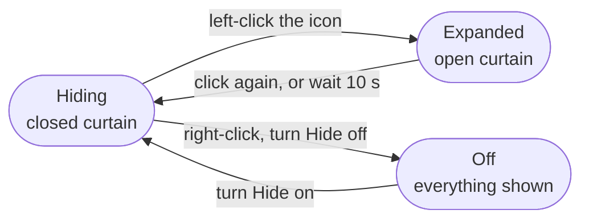
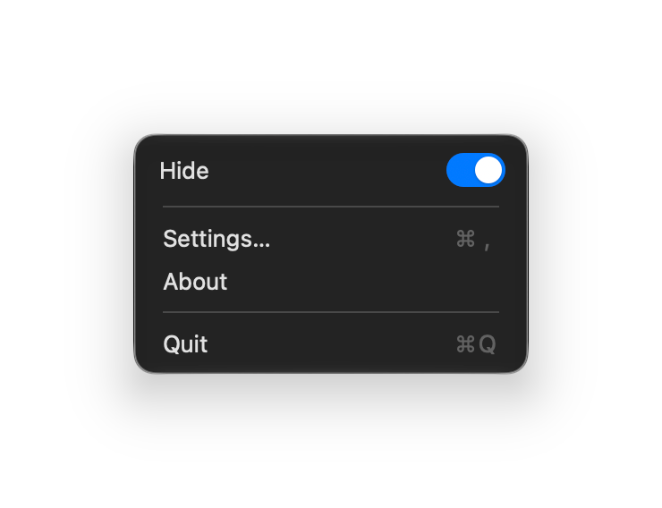
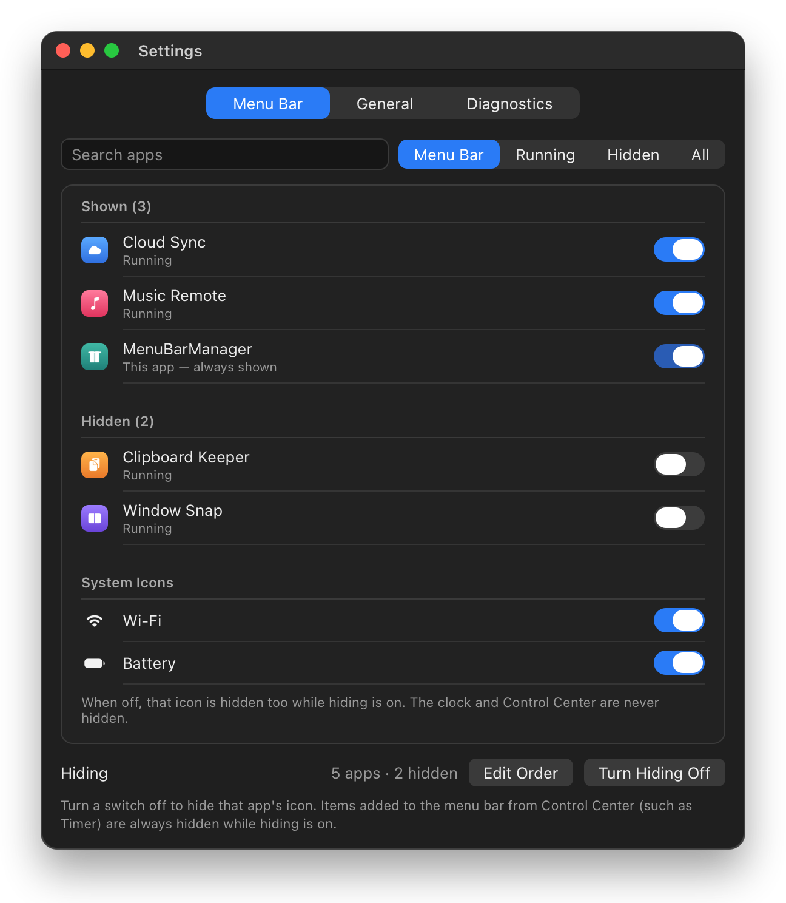
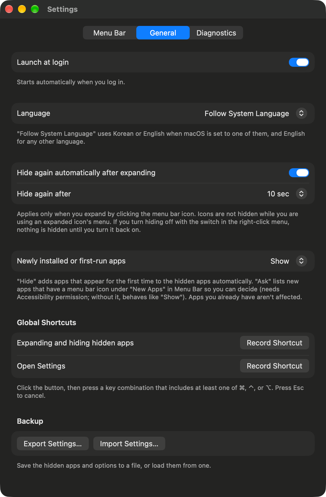

<h1 align="center">MenuBarManager</h1>

<p align="center">
  <b>Hide the menu bar icons you don't need. Bring them back with one click.</b>
</p>

<p align="center">
  <b>English</b> · <a href="README_KR.md">한국어</a> · <a href="README_CN.md">简体中文</a>
</p>

<p align="center">
  <a href="https://github.com/dohyoh/menubar-manager/releases/latest"></a>
  
  
</p>

<p align="center">
  
</p>

<p align="center">
  <sub>Top: hiding is on. Bottom: one click on the curtain icon shows the hidden icons (yellow) again.</sub>
</p>

## What it does

| | Feature | What you get |
|---|---|---|
| 🙈 | **Hide icons** | Pick, app by app, which icons stay in the menu bar. Wi-Fi and Battery can be hidden too. |
| 👆 | **One-click expand** | Left-click the curtain icon to show everything. Icons hide again by themselves after 10 seconds. |
| ↔️ | **Reorder icons** | Drag a list into the order you want, hidden apps included. |
| ⌨️ | **Global shortcuts** | Expand or hide from any app with a key combination. |
| 💾 | **Backup** | Save your settings to a file and load them back later. |
| 🔒 | **Private** | No network access. Settings stay in one file on your Mac. |

## Quick start

| Step | What to do |
|:---:|---|
| **1** | Download `MenuBarManager-<version>.zip` from the [latest release](https://github.com/dohyoh/menubar-manager/releases/latest) and unzip it. |
| **2** | Move `MenuBarManager.app` into the **Applications** folder. Hiding only works from there. |
| **3** | Open the app. The Settings window appears the first time. |
| **4** | In **Menu Bar**, turn off the switch of every app you want to hide. |
| **5** | Right-click the curtain icon in the menu bar and turn **Hide** on. |

<details>
<summary><b>macOS says the app can't be opened?</b></summary>

<br>

This app is not notarized by Apple, so macOS blocks it the first time. Unblock it in one of two ways:

- Open **System Settings > Privacy & Security**, scroll down, and click **Open Anyway**.
- Or run this in Terminal:

  ```bash
  xattr -dr com.apple.quarantine /Applications/MenuBarManager.app
  ```

More detail: [User guide — Install](docs/guide/user-guide.md#1-install).

</details>

## How to use



<table>
<tr>
<td>

| Action | Result |
|---|---|
| **Left-click** the curtain icon | Show hidden icons / hide them again |
| **Right-click** the curtain icon | Hide switch, Settings, About, Quit |
| **Click the clock** | Notification Center opens, even while hiding |
| **Your shortcut** | Expand / hide, or open Settings |

</td>
<td width="270" align="center">

</td>
</tr>
</table>

## Settings at a glance

<table>
<tr>
<th width="50%">Menu Bar — choose what to hide</th>
<th width="50%">General — options</th>
</tr>
<tr>
<td valign="top" align="center"></td>
<td valign="top" align="center"></td>
</tr>
</table>

| Tab | What you can do |
|---|---|
| **Menu Bar** | Show or hide each app and system icon, search and filter the list, **Edit Order** |
| **General** | Launch at login, language, hide again automatically, what to do with new apps, global shortcuts, backup |
| **Diagnostics** | Check why something is not working and copy the details |

<sub>The Menu Bar picture is an illustration with sample apps. The other pictures are real screenshots.</sub>

## Requirements

| Item | Detail |
|---|---|
| **macOS** | Runs on macOS 15 or later. **Hiding was verified on macOS 27.** On a version without the required system feature, hiding stays off and the app tells you why. |
| **Mac** | Apple silicon and Intel (universal). Not yet tested on an Intel Mac. |
| **Location** | The app must be in the Applications folder. |
| **Accessibility permission** | Optional. Needed for reordering and a few conveniences. Hiding and expanding work without it. |
| **Language** | English and Korean. Follows the macOS language (English for any other language). Change it in **Settings > General**. |

## Good to know

- Apps that live outside the Applications folder, and items added from Control Center (such as Timer), are not shown while hiding is on.
- Quitting MenuBarManager brings every hidden icon back.
- Hiding uses a private macOS feature. A macOS update may change how it works, and the app cannot be distributed on the Mac App Store.
- After you replace the app with a new version, allow the Accessibility permission again.

## Learn more

| I want to… | Read |
|---|---|
| Follow the install step by step, or fix a problem | [User guide](docs/guide/user-guide.md) |
| See what changed in each version | [Changelog](docs/CHANGELOG.md) (Korean) |
| Understand how it works inside | [Project overview](docs/overview.html) · [Document map](docs/README.md) (Korean) |

<details>
<summary><b>Build from source</b></summary>

<br>

You need Xcode and [XcodeGen](https://github.com/yonaskolb/XcodeGen).

```bash
./scripts/bootstrap.sh
```

```bash
CONFIG=Release ./scripts/build.sh install
```

Unit tests:

```bash
swift test --package-path Packages/MenuBarKit
```

</details>
