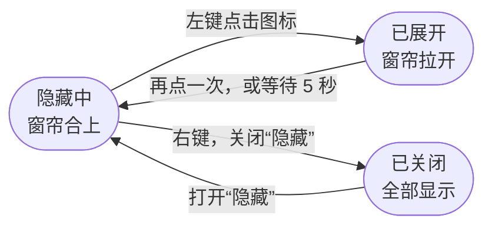
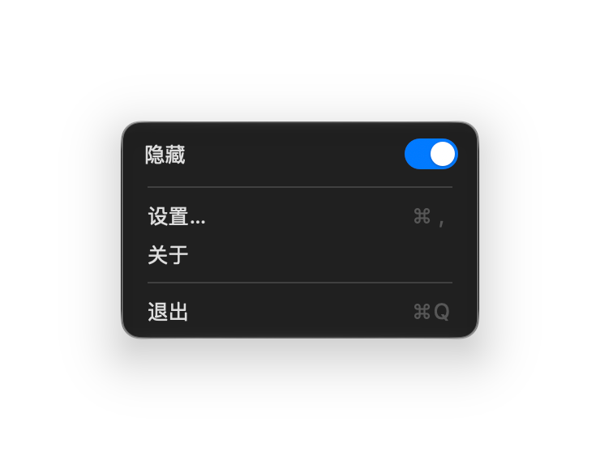
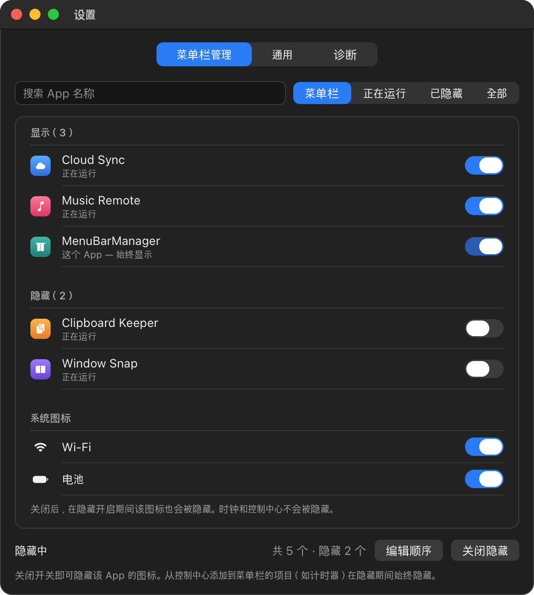
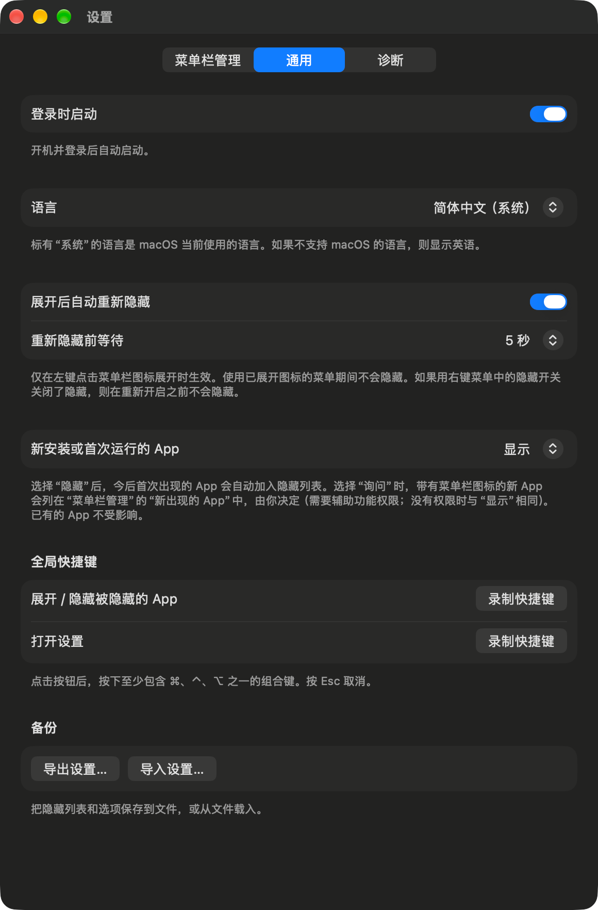

<h1 align="center">MenuBarManager</h1>

<p align="center">
  <b>把用不到的菜单栏图标藏起来，点一下就能全部找回。</b>
</p>

<p align="center">
  <a href="README.md">English</a> · <a href="README_KR.md">한국어</a> · <b>简体中文</b>
</p>

<p align="center">
  <a href="https://github.com/dohyoh/menubar-manager/releases/latest"></a>
  
  
</p>

<p align="center">
  
</p>

<p align="center">
  <sub>上：隐藏已开启。下：点一下窗帘图标，被隐藏的图标（黄色）重新出现。</sub>
</p>

## 功能

| | 功能 | 说明 |
|---|---|---|
| 🙈 | **隐藏图标** | 按 App 选择哪些图标留在菜单栏。Wi-Fi 和电池图标也可以隐藏。 |
| 👆 | **一键展开** | 左键点击窗帘图标即可显示全部图标，5 秒后自动重新隐藏。 |
| ↔️ | **调整顺序** | 拖动列表排出想要的顺序，被隐藏的 App 也包括在内。 |
| ⌨️ | **全局快捷键** | 在任何 App 中都能用组合键展开或隐藏。 |
| 💾 | **备份** | 把设置保存为文件，之后可以再导入。 |
| 🔒 | **隐私** | 不联网。设置只保存在你 Mac 上的一个文件里。 |

## 快速开始

| 步骤 | 操作 |
|:---:|---|
| **1** | 从[最新版本](https://github.com/dohyoh/menubar-manager/releases/latest)下载 `MenuBarManager-<版本>.zip` 并解压。 |
| **2** | 把 `MenuBarManager.app` 移到“**应用程序**”文件夹。放在其他位置时隐藏功能无法使用。 |
| **3** | 打开 App。第一次打开时会出现设置窗口。 |
| **4** | 在**菜单栏管理**标签页中，关闭想隐藏的 App 的开关。 |
| **5** | 右键点击菜单栏上的窗帘图标，打开**隐藏**开关。 |

<details>
<summary><b>macOS 提示无法打开 App？</b></summary>

<br>

这个 App 没有经过 Apple 公证，所以第一次打开时会被 macOS 拦截。可以用下面任意一种方法解除：

- 打开**系统设置 > 隐私与安全性**，向下滚动，点击**仍要打开**。
- 或者在“终端”中运行：

  ```bash
  xattr -dr com.apple.quarantine /Applications/MenuBarManager.app
  ```

详细说明：[使用指南 — 安装](docs/guide/user-guide_CN.md#1-安装)。

</details>

## 使用方法



<table>
<tr>
<td>

| 操作 | 结果 |
|---|---|
| **左键点击**窗帘图标 | 显示被隐藏的图标 / 重新隐藏 |
| **右键点击**窗帘图标 | “隐藏”开关、设置、关于、退出 |
| **点击时钟** | 隐藏期间也能打开通知中心 |
| **自定义快捷键** | 展开 / 隐藏，或打开设置 |

</td>
<td width="270" align="center">

</td>
</tr>
</table>

## 设置一览

<table>
<tr>
<th width="50%">菜单栏管理 — 选择要隐藏的图标</th>
<th width="50%">通用 — 选项</th>
</tr>
<tr>
<td valign="top" align="center"></td>
<td valign="top" align="center"></td>
</tr>
</table>

| 标签页 | 可以做什么 |
|---|---|
| **菜单栏管理** | 设置每个 App 和系统图标是否显示，搜索和筛选列表，**编辑顺序** |
| **通用** | 登录时启动、语言、自动重新隐藏、新 App 的处理方式、全局快捷键、备份 |
| **诊断** | 查看功能不工作的原因并拷贝诊断信息 |

<sub>“菜单栏管理”的图片是用示例 App 绘制的示意图，其余图片是真实截图。</sub>

## 系统要求

| 项目 | 说明 |
|---|---|
| **macOS** | 可在 macOS 15 或更高版本上运行。**隐藏功能已在 macOS 27 上验证**。如果系统缺少所需的功能，App 不会开启隐藏，并会说明原因。 |
| **Mac** | Apple 芯片和 Intel（通用二进制）。尚未在 Intel Mac 上测试。 |
| **位置** | App 必须放在“应用程序”文件夹中。 |
| **辅助功能权限** | 可选。调整顺序和少数便利功能需要它。隐藏和展开不需要权限。 |
| **语言** | 简体中文、英语、韩语。默认使用 macOS 的语言（不支持该语言时显示英语），可在**设置 > 通用**中更改。 |

## 须知

- 位于“应用程序”文件夹之外的 App，以及从控制中心添加到菜单栏的项目（如计时器），在隐藏期间不会显示。
- 退出 MenuBarManager 后，所有被隐藏的图标都会恢复显示。
- 隐藏功能使用了 macOS 的非公开功能。macOS 更新后行为可能改变，也无法在 Mac App Store 上架。
- 替换为新版本后，需要重新授予辅助功能权限。

## 了解更多

| 我想… | 文档 |
|---|---|
| 一步步完成安装，或解决问题 | [使用指南](docs/guide/user-guide_CN.md) |
| 查看每个版本的变化 | [更新日志](docs/CHANGELOG.md)（韩语） |
| 了解内部结构和工作原理 | [项目概览](docs/overview.html) · [文档地图](docs/README.md)（韩语） |

<details>
<summary><b>从源码构建</b></summary>

<br>

需要 Xcode 和 [XcodeGen](https://github.com/yonaskolb/XcodeGen)。

```bash
./scripts/bootstrap.sh
```

```bash
CONFIG=Release ./scripts/build.sh install
```

单元测试：

```bash
swift test --package-path Packages/MenuBarKit
```

</details>
