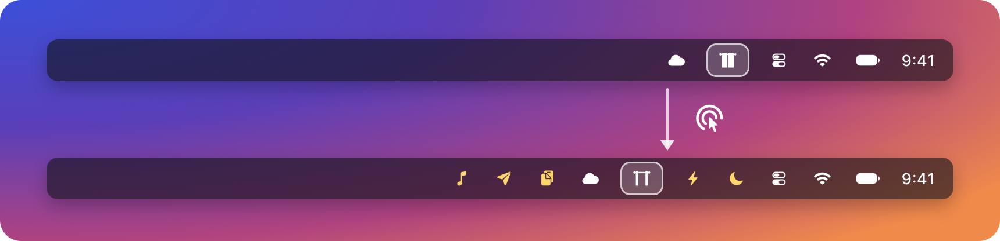
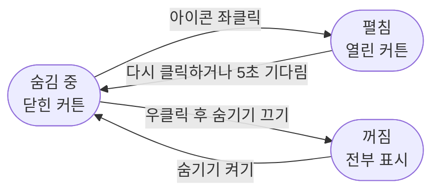
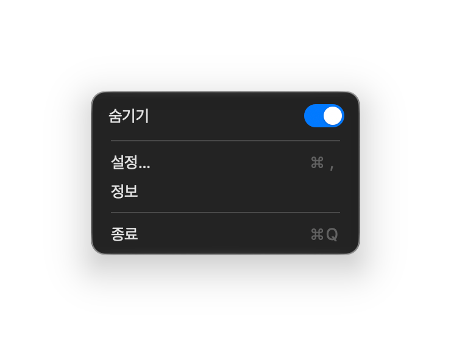
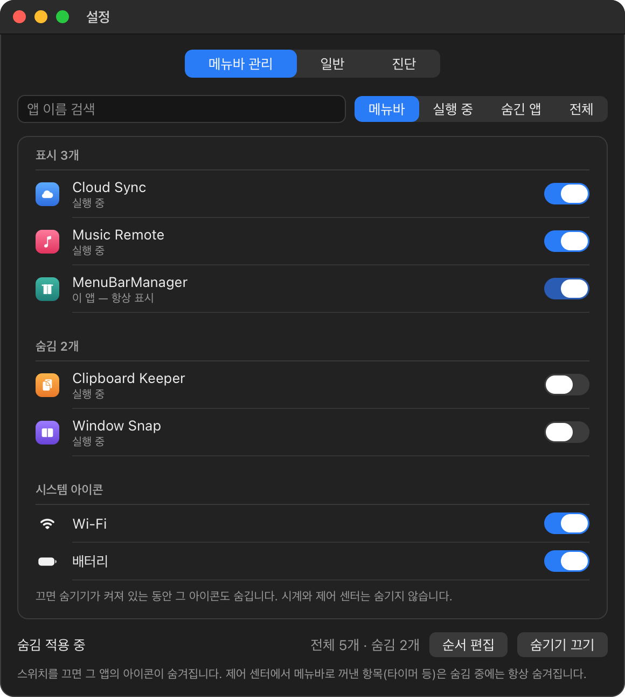
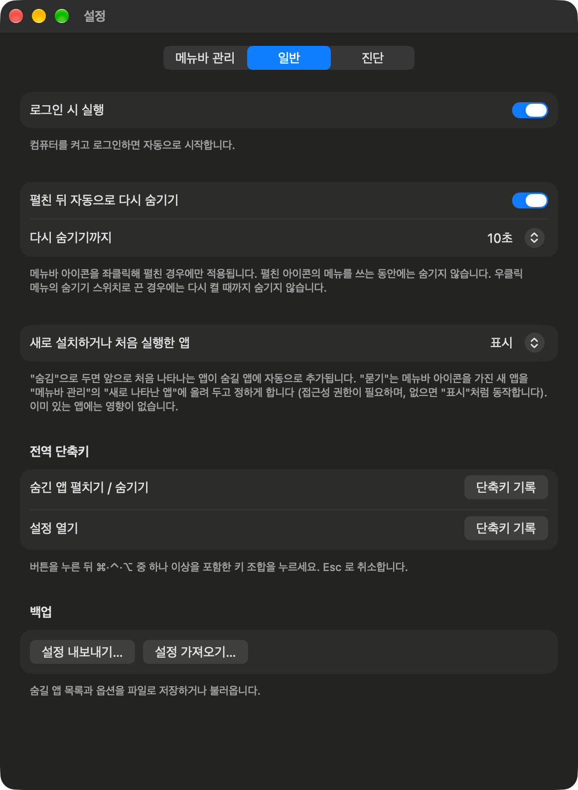

<h1 align="center">MenuBarManager</h1>

<p align="center">
  <b>필요 없는 메뉴바 아이콘은 숨기고, 클릭 한 번으로 다시 꺼내 봅니다.</b>
</p>

<p align="center">
  <a href="README.md">English</a> · <b>한국어</b> · <a href="README_CN.md">简体中文</a>
</p>

<p align="center">
  <a href="https://github.com/dohyoh/menubar-manager/releases/latest"></a>
  
  
</p>

<p align="center">
  
</p>

<p align="center">
  <sub>위: 숨김이 켜진 상태. 아래: 커튼 아이콘을 한 번 누르면 숨긴 아이콘(노란색)이 다시 나타납니다.</sub>
</p>

## 무엇을 하나요

| | 기능 | 설명 |
|---|---|---|
| 🙈 | **아이콘 숨기기** | 메뉴바에 남길 아이콘을 앱별로 고릅니다. Wi-Fi와 배터리도 숨길 수 있습니다. |
| 👆 | **클릭 한 번으로 펼치기** | 커튼 아이콘을 좌클릭하면 전부 나타나고, 5초 뒤 저절로 다시 숨습니다. |
| ↔️ | **순서 바꾸기** | 목록을 끌어서 원하는 순서로 정리합니다. 숨긴 앱도 포함됩니다. |
| ⌨️ | **전역 단축키** | 어느 앱을 쓰는 중이든 키 조합으로 펼치거나 숨깁니다. |
| 💾 | **백업** | 설정을 파일로 저장했다가 다시 불러옵니다. |
| 🔒 | **개인정보** | 네트워크 통신을 하지 않습니다. 설정은 내 Mac의 파일 하나에만 저장됩니다. |

## 빠른 시작

| 단계 | 할 일 |
|:---:|---|
| **1** | [최신 릴리스](https://github.com/dohyoh/menubar-manager/releases/latest)에서 `MenuBarManager-<버전>.zip`을 받아 압축을 풉니다. |
| **2** | `MenuBarManager.app`을 **응용 프로그램** 폴더로 옮깁니다. 다른 위치에서는 숨김이 동작하지 않습니다. |
| **3** | 앱을 엽니다. 처음에는 설정 창이 나타납니다. |
| **4** | **메뉴바 관리**에서 숨기고 싶은 앱의 스위치를 끕니다. |
| **5** | 메뉴바의 커튼 아이콘을 우클릭해 **숨기기**를 켭니다. |

<details>
<summary><b>macOS가 앱을 열 수 없다고 하나요?</b></summary>

<br>

이 앱은 Apple의 공증을 받지 않아서, 처음 열 때 macOS가 실행을 막습니다. 다음 중 하나로 풉니다.

- **시스템 설정 > 개인정보 보호 및 보안**을 열고 아래로 내려 **그래도 열기**를 누릅니다.
- 또는 터미널에서 다음을 실행합니다.

  ```bash
  xattr -dr com.apple.quarantine /Applications/MenuBarManager.app
  ```

자세한 내용: [사용 안내서 — 설치](docs/guide/user-guide_KR.md#1-설치).

</details>

## 사용법



<table>
<tr>
<td>

| 동작 | 결과 |
|---|---|
| 커튼 아이콘 **좌클릭** | 숨긴 아이콘 펼치기 / 다시 숨기기 |
| 커튼 아이콘 **우클릭** | 숨기기 스위치, 설정, 정보, 종료 |
| **시계 클릭** | 숨김 중에도 알림 센터가 열림 |
| **지정한 단축키** | 펼치기 / 숨기기, 또는 설정 열기 |

</td>
<td width="270" align="center">

</td>
</tr>
</table>

## 설정 한눈에 보기

<table>
<tr>
<th width="50%">메뉴바 관리 — 숨길 앱 고르기</th>
<th width="50%">일반 — 옵션</th>
</tr>
<tr>
<td valign="top" align="center"></td>
<td valign="top" align="center"></td>
</tr>
</table>

| 탭 | 할 수 있는 일 |
|---|---|
| **메뉴바 관리** | 앱과 시스템 아이콘의 표시 여부, 목록 검색과 필터, **순서 편집** |
| **일반** | 로그인 시 실행, 언어, 자동으로 다시 숨기기, 새 앱 처리 방식, 전역 단축키, 백업 |
| **진단** | 동작하지 않는 이유를 확인하고 정보를 복사 |

<sub>메뉴바 관리 그림은 예시 앱으로 그린 것이고, 나머지는 실제 화면입니다.</sub>

## 요구 사항

| 항목 | 내용 |
|---|---|
| **macOS** | macOS 15 이상에서 실행됩니다. **숨김 기능은 macOS 27과 macOS 26.5에서 확인했습니다.** macOS 26 이하에서는 다른 방식으로 숨기며, 1.0.2 다음 버전부터 지원합니다 (macOS 15~25는 확인하지 못했습니다). 숨김을 켤 수 없으면 켜지 않고 그 이유를 알려 줍니다. |
| **Mac** | Apple 실리콘과 Intel (범용). Intel Mac에서는 아직 실행해 보지 않았습니다. |
| **위치** | 앱이 응용 프로그램 폴더에 있어야 합니다. |
| **손쉬운 사용 권한** | macOS 27에서는 선택 사항입니다 — 순서 바꾸기와 일부 편의 기능에 필요하고, 숨기기와 펼치기는 권한 없이 동작합니다. **macOS 26 이하에서는 숨기기에도 필요합니다.** |
| **언어** | 한국어, 영어, 중국어(간체). macOS의 언어로 시작하고(지원하지 않는 언어이면 영어), **설정 > 일반**에서 바꿀 수 있습니다. |

## 알아 둘 점

- 응용 프로그램 폴더 밖에 있는 앱과, 제어 센터에서 메뉴바로 꺼낸 항목(타이머 등)은 숨김 중에는 표시되지 않습니다.
- MenuBarManager를 종료하면 숨긴 아이콘은 모두 돌아옵니다.
- 숨김은 macOS의 비공개 기능을 사용합니다. macOS 업데이트로 동작이 바뀔 수 있고, Mac App Store에는 올릴 수 없습니다.
- macOS 26 이하에서는 숨길 앱을 바꾸거나 숨김 중에 새 앱을 실행하면, 아이콘을 옮기느라 숨긴 아이콘이 잠깐 보이고 포인터가 잠시 움직입니다. 이 버전에서는 시계와 제어 센터를 뺀 시스템 아이콘(Wi-Fi, 배터리, 입력 소스, Siri 등)을 숨길 수 있습니다.
- 새 버전으로 바꾸면 손쉬운 사용 권한을 다시 허용해야 합니다.

## 더 알아보기

| 하고 싶은 일 | 문서 |
|---|---|
| 설치를 단계별로 따라 하거나 문제를 해결 | [사용 안내서](docs/guide/user-guide_KR.md) |
| 버전별 변경 내용 확인 | [변경 이력](docs/CHANGELOG.md) |
| 내부 구조와 동작 원리 이해 | [한눈에 보기](docs/overview.html) · [문서 지도](docs/README.md) |

<details>
<summary><b>직접 빌드</b></summary>

<br>

Xcode와 [XcodeGen](https://github.com/yonaskolb/XcodeGen)이 필요합니다.

```bash
./scripts/bootstrap.sh
```

```bash
CONFIG=Release ./scripts/build.sh install
```

단위 테스트:

```bash
swift test --package-path Packages/MenuBarKit
```

</details>
