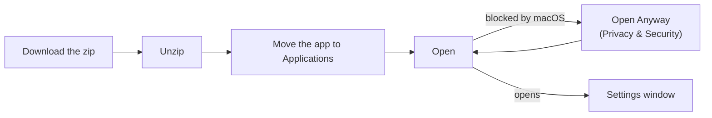
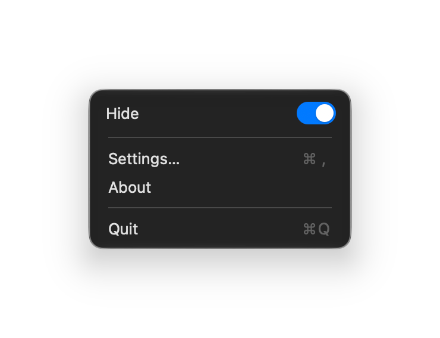
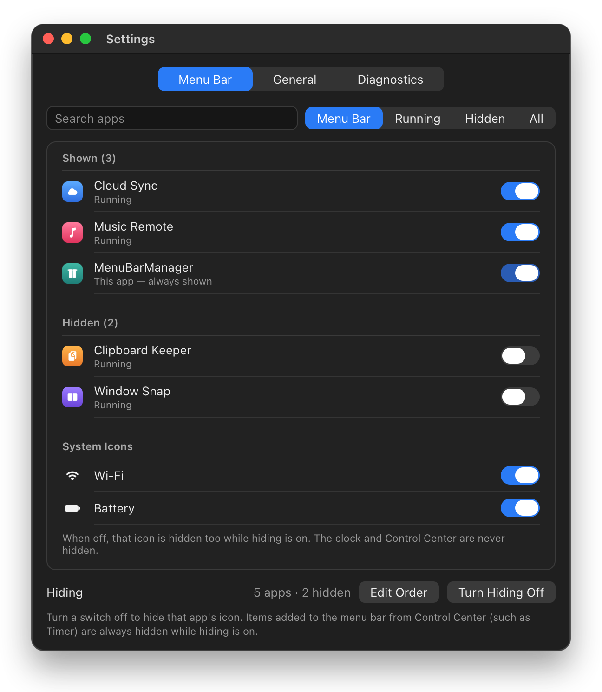
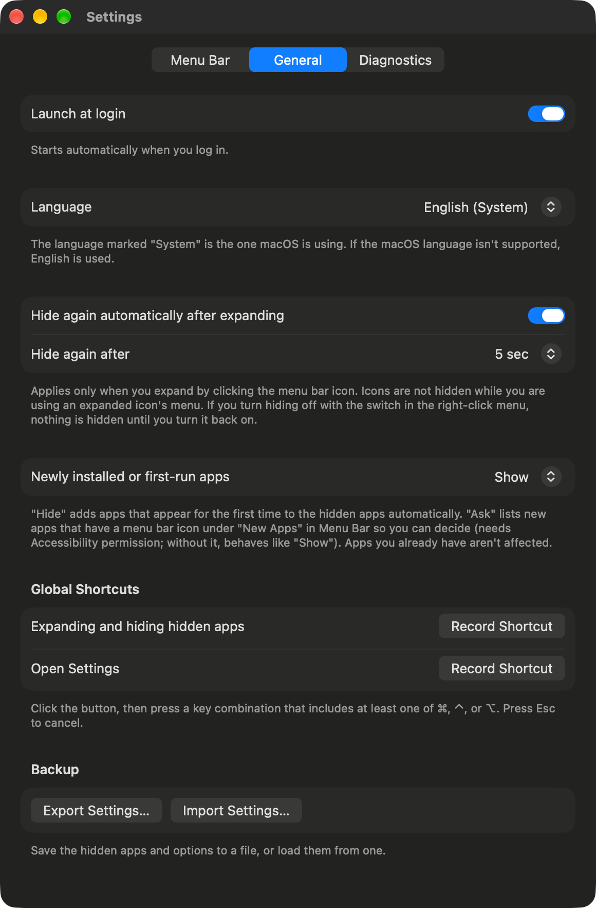

# MenuBarManager user guide

**English** · [한국어](user-guide_KR.md) · [简体中文](user-guide_CN.md)

Everything in the [README](../../README.md), step by step, plus fixes for common problems.

| Section | When to read it |
|---|---|
| [1. Install](#1-install) | First time, or macOS refuses to open the app |
| [2. Everyday use](#2-everyday-use) | What each click does |
| [3. Choose what to hide](#3-choose-what-to-hide) | The **Menu Bar** tab |
| [4. Reorder icons](#4-reorder-icons) | **Edit Order** and the Accessibility permission |
| [5. Options](#5-options) | The **General** tab |
| [6. Troubleshooting](#6-troubleshooting) | Something does not work |
| [7. Update and uninstall](#7-update-and-uninstall) | New version, or removing the app |
| [8. Privacy and how it works](#8-privacy-and-how-it-works) | What the app touches on your Mac |

## 1. Install



1. Open the [latest release](https://github.com/dohyoh/menubar-manager/releases/latest) and download `MenuBarManager-<version>.zip`.
2. Double-click the zip to unzip it.
3. Drag `MenuBarManager.app` into the **Applications** folder.
4. Open it from Applications.

### If macOS blocks the app

The app is not notarized by Apple ([why](../adr/0011-unnotarized-release.md), Korean), so macOS shows a warning the first time.

| Way | Steps |
|---|---|
| **System Settings** | 1. Try to open the app once and close the warning. 2. Open **System Settings > Privacy & Security**. 3. Scroll down to the message about MenuBarManager and click **Open Anyway**. 4. Confirm with your password or Touch ID. |
| **Terminal** | Run the command below, then open the app again. |

```bash
xattr -dr com.apple.quarantine /Applications/MenuBarManager.app
```

### If the app asks to be moved

Hiding only works when the app runs from the Applications folder. If you open it somewhere else, it offers a **Move to Applications** button. Click it and the app copies itself there and reopens.

## 2. Everyday use

The app lives in the menu bar as a curtain icon. A closed curtain means icons are hidden. An open curtain means everything is showing.


| Action | Result |
|---|---|
| **Left-click** the curtain icon | Show the hidden icons. Click again to hide them. |
| **Right-click** the curtain icon | Open the menu: **Hide** switch, **Settings…**, **About**, **Quit** |
| Turn the **Hide** switch off | Everything stays visible until you turn it back on |
| **Click the clock** | Notification Center opens, even while hiding |
| Open the app again from Applications | The Settings window appears (useful when you cannot find the icon) |



Hiding is **off** the first time you run the app. Choose the apps to hide first ([section 3](#3-choose-what-to-hide)), then turn **Hide** on.

### Notification Center

- Clicking the clock opens Notification Center while hiding is on. Hidden icons are visible while it is open and hide again right after you close it (this can take longer without the Accessibility permission).
- Swiping with two fingers on the trackpad does not open it while hiding is on. Left-click the curtain icon to expand first.

## 3. Choose what to hide

Open **Settings > Menu Bar** (right-click the curtain icon, then **Settings…**).



<sub>Illustration with sample apps.</sub>

- **Switch on** = the icon stays in the menu bar. **Switch off** = the icon is hidden.
- The list is split into **Shown**, **Hidden**, and **System Icons** (Wi-Fi and Battery). The clock and Control Center are never hidden.
- MenuBarManager itself is always shown.
- **Turn Hiding On / Off** at the bottom does the same as the Hide switch in the right-click menu.

| Filter | Shows |
|---|---|
| **Menu Bar** | Only apps that have a menu bar icon. Needs the Accessibility permission. |
| **Running** | Apps that are running now |
| **Hidden** | Apps you have hidden |
| **All** | Every app, including installed apps that are not running |

### Icons that cannot be shown while hiding

| Item | While hiding is on |
|---|---|
| Apps outside the Applications folder | Not shown |
| Items added to the menu bar from Control Center (such as Timer) | Not shown |

Left-click the curtain icon to expand, or turn Hide off, to see them.

## 4. Reorder icons

1. Open **Settings > Menu Bar** and click **Edit Order**.
2. The first time, click **Request Accessibility Permission** and allow MenuBarManager in **System Settings > Privacy & Security > Accessibility**.
3. Click **Read Order from Menu Bar**. The list now shows the icons in their real order.
4. Drag rows into the order you want. System items are fixed and cannot be moved.
5. Click **Apply**. The pointer moves by itself for a few seconds while the icons are moved. Leave the mouse alone until it finishes.

**Cancel**, or switching to another tab, leaves the menu bar unchanged.

You can also hold **⌘ (Command)** and drag an icon directly in the menu bar. Expand first to move a hidden icon.

## 5. Options

Open **Settings > General**.



| Option | What it does | Default |
|---|---|---|
| **Launch at login** | Starts the app when you log in | Off |
| **Language** | **한국어**, **English**, or **简体中文**. The language macOS is using is marked **(System)** and is selected at first. If macOS uses a language the app doesn't support, English is selected. A change takes effect after a restart; click **Restart Now** right below. | macOS language |
| **Hide again automatically after expanding** | After a left-click expand, hides the icons again after the chosen time. It waits while you are using an expanded icon's menu. | On |
| **Hide again after** | 3, 5, 10, 15, 30, or 60 seconds | 5 sec |
| **Newly installed or first-run apps** | **Show**: the new icon is visible. **Hide**: new apps are hidden automatically. **Ask**: new apps are listed under **New Apps** in the Menu Bar tab so you can decide (needs the Accessibility permission). | Show |
| **Global Shortcuts** | Key combinations for expand / hide and for opening Settings | None |
| **Backup** | **Export Settings…** saves the hidden apps and options to a file. **Import Settings…** loads them. | — |

### Record a shortcut

1. Click **Record Shortcut**.
2. Press a key combination that includes at least one of ⌘, ⌃, or ⌥.
3. Press **Esc** to cancel. Click **Clear** to remove a shortcut.

If a message says the combination could not be registered, another app is probably using it. Choose a different one.

## 6. Troubleshooting

Start with **Settings > Diagnostics**. It shows whether hiding is available, whether the app is in the Applications folder, and whether the Accessibility permission is allowed. **Copy Diagnostics** copies the details so you can paste them into a bug report.

| Problem | What to do |
|---|---|
| macOS says the app cannot be opened | See [If macOS blocks the app](#if-macos-blocks-the-app) |
| I cannot find the curtain icon | Open MenuBarManager again from the Applications folder. The Settings window appears. |
| Hide cannot be turned on, and the app asks to be moved | Click **Move to Applications**, or drag the app into Applications yourself and reopen it |
| "Hiding is not available on this version of macOS" | This macOS version lacks the system feature the app needs. Hiding was verified on macOS 27. |
| An app's switch is on but its icon is missing | The app is outside the Applications folder, or it is a Control Center item. See [section 3](#icons-that-cannot-be-shown-while-hiding). |
| Edit Order stopped working after an update | Allow the Accessibility permission again. See [Update](#update). |
| Notification Center does not open with a trackpad swipe | Left-click the curtain icon to expand first, or click the clock |
| A shortcut does nothing | Record a different combination. Another app may be using it. |
| My settings were reset | If the settings file could not be read, the app starts with defaults and keeps the old file as `state.unreadable.json` in the settings folder (see [section 8](#8-privacy-and-how-it-works)). |

Still stuck? Open an [issue](https://github.com/dohyoh/menubar-manager/issues) and paste the copied diagnostics.

## 7. Update and uninstall

### Update

1. Download the new zip from the [latest release](https://github.com/dohyoh/menubar-manager/releases/latest).
2. Quit MenuBarManager (right-click the curtain icon, then **Quit**).
3. Replace the app in the Applications folder with the new one and open it. macOS may block it again the first time ([section 1](#if-macos-blocks-the-app)).
4. Allow the Accessibility permission again. The old permission entry does not match the new version, so reset it in Terminal first:

   ```bash
   tccutil reset Accessibility dev.menubarmanager.app
   ```

   Then click **Request Accessibility Permission** in **Edit Order** and allow MenuBarManager in System Settings.

Your settings are kept.

### Uninstall

1. In **Settings > General**, turn **Launch at login** off.
2. Quit MenuBarManager. Every hidden icon comes back.
3. Move `MenuBarManager.app` from Applications to the Trash.
4. Optional: delete the settings folder `~/Library/Application Support/MenuBarManager`.

## 8. Privacy and how it works

| Topic | Detail |
|---|---|
| **Network** | The app does not connect to the network. |
| **Settings file** | `~/Library/Application Support/MenuBarManager/state.json` — the hidden apps and your options. Nothing else is stored. |
| **Accessibility permission** | Used to read the positions of menu bar icons and to move them. Optional. |
| **How hiding works** | A private macOS feature limits which apps may show a menu bar icon. Because it is private, a macOS update may change it. |
| **If something fails** | The app is built to fall back to showing every icon. |

For developers (Korean): [platform notes](../architecture/platform-notes.md) · [architecture](../architecture/overview.md) · [decision records](../adr/README.md)
