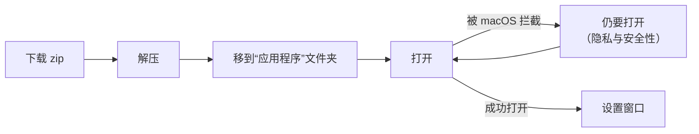
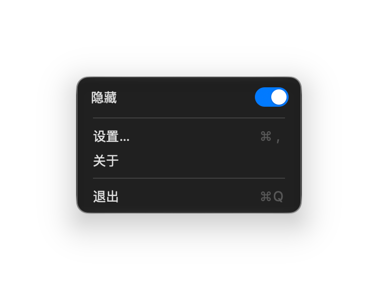
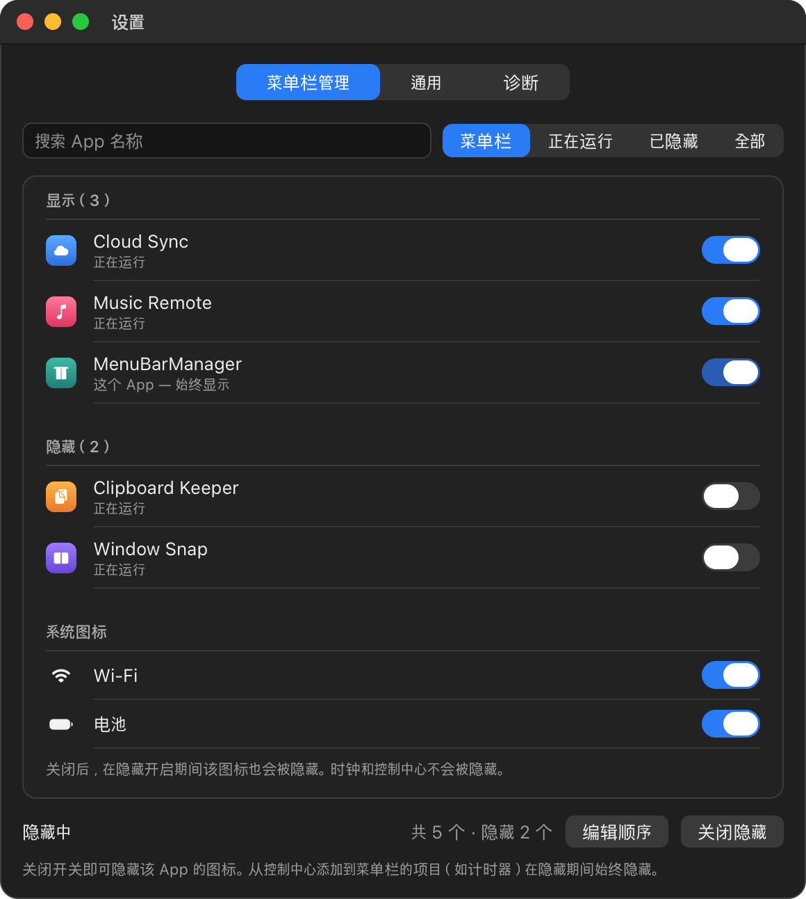
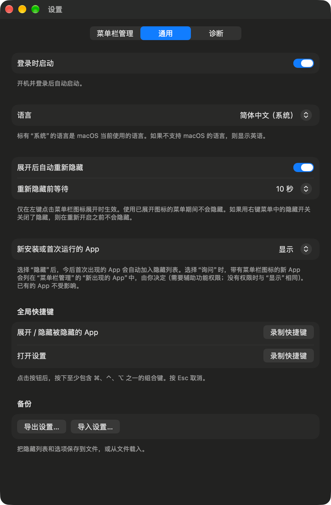

# MenuBarManager 使用指南

[English](user-guide.md) · [한국어](user-guide_KR.md) · **简体中文**

把 [README](../../README_CN.md) 中的内容一步步展开说明，并整理了常见问题的解决方法。

| 章节 | 什么时候看 |
|---|---|
| [1. 安装](#1-安装) | 第一次安装，或 macOS 不让打开 App |
| [2. 日常使用](#2-日常使用) | 每种点击分别做什么 |
| [3. 选择要隐藏的图标](#3-选择要隐藏的图标) | **菜单栏管理**标签页 |
| [4. 调整图标顺序](#4-调整图标顺序) | **编辑顺序**和辅助功能权限 |
| [5. 选项](#5-选项) | **通用**标签页 |
| [6. 故障排除](#6-故障排除) | 有功能不工作 |
| [7. 更新与卸载](#7-更新与卸载) | 换新版本，或删除 App |
| [8. 隐私与工作原理](#8-隐私与工作原理) | App 会接触 Mac 上的哪些内容 |

## 1. 安装



1. 打开[最新版本](https://github.com/dohyoh/menubar-manager/releases/latest)，下载 `MenuBarManager-<版本>.zip`。
2. 双击 zip 文件解压。
3. 把 `MenuBarManager.app` 拖到“**应用程序**”文件夹。
4. 从“应用程序”文件夹打开它。

### macOS 拦截 App 时

这个 App 没有经过 Apple 公证（[原因](../adr/0011-unnotarized-release.md)，韩语），所以第一次打开时 macOS 会显示警告。

| 方法 | 步骤 |
|---|---|
| **系统设置** | 1. 先尝试打开一次 App，然后关闭警告。 2. 打开**系统设置 > 隐私与安全性**。 3. 向下滚动到有关 MenuBarManager 的提示，点击**仍要打开**。 4. 用密码或触控 ID 确认。 |
| **终端** | 运行下面的命令，然后重新打开 App。 |

```bash
xattr -dr com.apple.quarantine /Applications/MenuBarManager.app
```

### App 要求移动位置时

只有从“应用程序”文件夹运行时，隐藏功能才能工作。如果在其他位置打开，App 会显示**移到“应用程序”文件夹**按钮。点击后，App 会把自己复制到“应用程序”文件夹并重新打开。

## 2. 日常使用

App 以窗帘图标的形式常驻菜单栏。窗帘合上表示图标正被隐藏，窗帘拉开表示全部图标都在显示。


| 操作 | 结果 |
|---|---|
| **左键点击**窗帘图标 | 显示被隐藏的图标。再点一次重新隐藏。 |
| **右键点击**窗帘图标 | 打开菜单：**隐藏**开关、**设置…**、**关于**、**退出** |
| 关闭**隐藏**开关 | 所有图标一直显示，直到再次打开开关 |
| **点击时钟** | 隐藏期间也能打开通知中心 |
| 从“应用程序”文件夹再次打开 App | 出现设置窗口（找不到图标时很有用） |



第一次运行时，隐藏功能是**关闭**的。请先选择要隐藏的 App（[第 3 节](#3-选择要隐藏的图标)），再打开**隐藏**。

### 通知中心

- 隐藏期间点击时钟可以打开通知中心。通知中心打开时，被隐藏的图标会显示出来，关闭后马上重新隐藏（没有辅助功能权限时可能会慢一些）。
- 隐藏期间，用双指在触控板上轻扫无法打开通知中心。请先左键点击窗帘图标展开。

### 在 macOS 26 及更早版本上

在 macOS 26 及更早版本上，App 用另一种方式隐藏图标（从 1.0.2 之后的版本开始支持）。用法相同，但有以下区别：

- **隐藏需要辅助功能权限**，因为 MenuBarManager 需要代你移动要隐藏的 App 的图标。没有权限时，窗帘图标会变成感叹号图标，设置窗口中会显示说明。点击**请求辅助功能权限**，并在**系统设置 > 隐私与安全性 > 辅助功能**中打开 MenuBarManager，稍后即可使用隐藏。
- 更改要隐藏的 App，或在隐藏期间打开新的 App 时，由于需要移动图标，被隐藏的图标会暂时显示，指针也会短暂移动。左键点击展开和隐藏时不会这样。
- 系统图标：列表下方的**系统图标**区域会列出当前菜单栏中可以移动的图标（Wi-Fi、电池、输入法、Siri 等）。时钟和控制中心的位置由 macOS 固定，无法隐藏。
- 把隐藏的图标重新设为显示时，它会回到原来的位置。如果是在重新启动 MenuBarManager 之后更改，它会被放在可见图标的最左侧（可以按住 ⌘ 拖动来调整）。
- 隐藏期间通知中心可以照常打开。
- 位于“应用程序”文件夹之外的 App 和控制中心项目在隐藏期间也会显示。
- 菜单栏中会多出一个很窄的空位。位于它左侧的图标就是会被隐藏的图标。

## 3. 选择要隐藏的图标

打开**设置 > 菜单栏管理**（右键点击窗帘图标，然后选择**设置…**）。



<sub>用示例 App 绘制的示意图。</sub>

- **开关打开** = 图标留在菜单栏。**开关关闭** = 图标被隐藏。
- 列表分为**显示**、**隐藏**和**系统图标**（Wi-Fi 和电池）三个区域。时钟和控制中心不会被隐藏。
- MenuBarManager 自己的图标始终显示。
- 底部的**开启隐藏 / 关闭隐藏**按钮与右键菜单中的“隐藏”开关作用相同。

| 筛选 | 显示内容 |
|---|---|
| **菜单栏** | 只显示有菜单栏图标的 App。需要辅助功能权限。 |
| **正在运行** | 正在运行的 App |
| **已隐藏** | 已设为隐藏的 App |
| **全部** | 所有 App，包括已安装但未运行的 |

### 隐藏期间无法显示的图标

| 项目 | 隐藏开启时 |
|---|---|
| 位于“应用程序”文件夹之外的 App | 不显示 |
| 从控制中心添加到菜单栏的项目（如计时器） | 不显示 |

要查看它们，请左键点击窗帘图标展开，或关闭“隐藏”。

## 4. 调整图标顺序

1. 打开**设置 > 菜单栏管理**，点击**编辑顺序**。
2. 第一次使用时，点击**请求辅助功能权限**，并在**系统设置 > 隐私与安全性 > 辅助功能**中允许 MenuBarManager。
3. 点击**从菜单栏读取顺序**。列表会按图标的实际顺序显示。
4. 拖动各行，排成想要的顺序。系统项目是固定的，不能移动。
5. 点击**应用**。移动图标的几秒钟内，指针会自己移动。完成之前请不要碰鼠标。

点击**取消**或切换到其他标签页，菜单栏不会有任何变化。

也可以按住 **⌘**（Command）键，直接在菜单栏中拖动图标。要移动被隐藏的图标，请先展开。

## 5. 选项

打开**设置 > 通用**。



| 选项 | 作用 | 默认值 |
|---|---|---|
| **登录时启动** | 登录时自动启动 App | 关 |
| **语言** | 可选择 **한국어**（韩语）、**English**（英语）或**简体中文**。macOS 正在使用的语言后面会标有“（系统）”，并且一开始就选中它。如果 App 不支持 macOS 的语言，则选中 English。更改后需要重新启动 App 才会生效，点击下方的**立即重新启动**即可。 | macOS 的语言 |
| **展开后自动重新隐藏** | 左键展开后，经过设定的时间自动重新隐藏。使用已展开图标的菜单时会等待。 | 开 |
| **重新隐藏前等待** | 3、5、10、15、30 或 60 秒 | 5 秒 |
| **新安装或首次运行的 App** | **显示**：新图标直接显示。**隐藏**：新 App 自动隐藏。**询问**：新 App 会列在“菜单栏管理”标签页的**新出现的 App**中，由你决定（需要辅助功能权限）。 | 显示 |
| **全局快捷键** | 用于展开 / 隐藏以及打开设置的组合键 | 无 |
| **备份** | **导出设置…** 把隐藏列表和选项保存为文件，**导入设置…** 从文件导入。 | — |

### 录制快捷键

1. 点击**录制快捷键**。
2. 按下至少包含 ⌘、⌃、⌥ 之一的组合键。
3. 按 **Esc** 取消。点击**清除**可删除快捷键。

如果提示组合键无法注册，很可能是其他 App 正在使用它。请换一个组合键。

## 6. 故障排除

先看**设置 > 诊断**。这里会显示隐藏功能是否可用、App 是否在“应用程序”文件夹中、辅助功能权限是否已允许。点击**拷贝诊断信息**可以拷贝这些信息，方便粘贴到问题反馈中。

| 问题 | 解决方法 |
|---|---|
| macOS 提示无法打开 App | 参见 [macOS 拦截 App 时](#macos-拦截-app-时) |
| 找不到窗帘图标 | 从“应用程序”文件夹再次打开 MenuBarManager，设置窗口会出现。 |
| 无法打开“隐藏”，App 要求移动位置 | 点击**移到“应用程序”文件夹**，或自己把 App 拖到“应用程序”文件夹后重新打开 |
| “此 macOS 版本无法使用隐藏功能” | 这个版本的 App 在当前 macOS 上没有可用的隐藏方式。如果是 macOS 26 或更早版本，请更新到 1.0.2 之后的版本。 |
| “隐藏需要辅助功能权限”（macOS 26 及更早版本） | 点击**请求辅助功能权限**，并在系统设置中打开 MenuBarManager。打开后仍无变化时，按[更新](#更新)第 4 步重置权限记录后再打开。 |
| 开关是打开的，但图标不见了 | 该 App 位于“应用程序”文件夹之外，或者它是控制中心项目。参见[第 3 节](#隐藏期间无法显示的图标)。 |
| 更新后“编辑顺序”不工作 | 重新授予辅助功能权限。参见[更新](#更新)。 |
| 在触控板上轻扫打不开通知中心 | 先左键点击窗帘图标展开，或点击时钟 |
| 快捷键没有反应 | 换一个组合键重新录制。可能有其他 App 正在使用它。 |
| 设置被重置了 | 如果设置文件无法读取，App 会以默认值启动，并把旧文件以 `state.unreadable.json` 的名字保留在设置文件夹中（参见[第 8 节](#8-隐私与工作原理)）。 |

还是没解决？请提交 [issue](https://github.com/dohyoh/menubar-manager/issues)，并粘贴拷贝的诊断信息。

## 7. 更新与卸载

### 更新

1. 从[最新版本](https://github.com/dohyoh/menubar-manager/releases/latest)下载新的 zip。
2. 退出 MenuBarManager（右键点击窗帘图标，然后选择**退出**）。
3. 用新 App 替换“应用程序”文件夹中的旧 App 并打开。第一次打开时 macOS 可能再次拦截（[第 1 节](#macos-拦截-app-时)）。
4. 重新授予辅助功能权限。旧的权限记录与新版本不匹配，所以先在“终端”中重置：

   ```bash
   tccutil reset Accessibility dev.menubarmanager.app
   ```

   然后在**编辑顺序**中点击**请求辅助功能权限**，并在系统设置中允许 MenuBarManager。

你的设置会保留。

### 卸载

1. 在**设置 > 通用**中关闭**登录时启动**。
2. 退出 MenuBarManager。所有被隐藏的图标都会恢复显示。
3. 把“应用程序”文件夹中的 `MenuBarManager.app` 移到废纸篓。
4. 可选：删除设置文件夹 `~/Library/Application Support/MenuBarManager`。

## 8. 隐私与工作原理

| 主题 | 说明 |
|---|---|
| **网络** | App 不连接网络。 |
| **设置文件** | `~/Library/Application Support/MenuBarManager/state.json` — 隐藏列表和选项。不保存其他内容。 |
| **辅助功能权限** | 用于读取菜单栏图标的位置并移动它们。在 macOS 27 上可选；在 macOS 26 及更早版本上，隐藏需要此权限。 |
| **隐藏的原理** | macOS 27：通过 macOS 的一项非公开功能，限制哪些 App 可以显示菜单栏图标。因为是非公开功能，macOS 更新后可能发生变化。macOS 26 及更早版本：App 把自己的一个不可见图标拉得非常长，把它左侧的图标推到屏幕之外。 |
| **出现问题时** | App 的设计是：遇到任何错误都回到“显示全部图标”的状态。 |

开发者文档（韩语）：[平台调研记录](../architecture/platform-notes.md) · [架构](../architecture/overview.md) · [决策记录](../adr/README.md)
