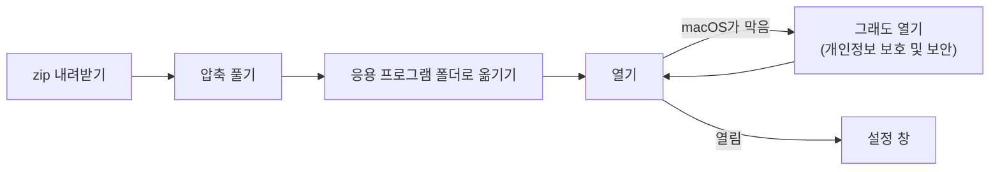
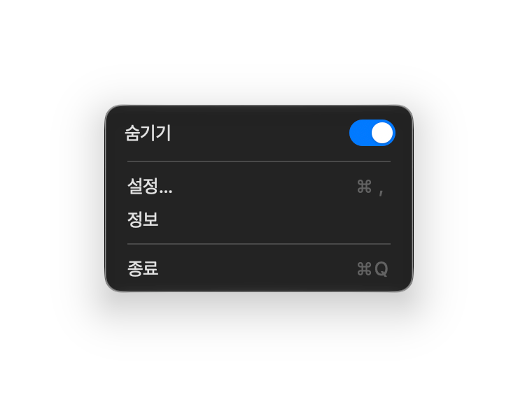
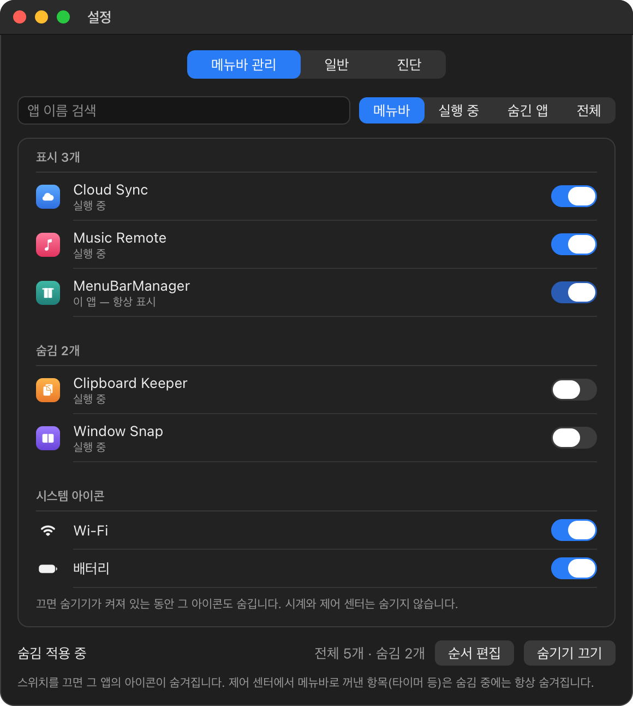
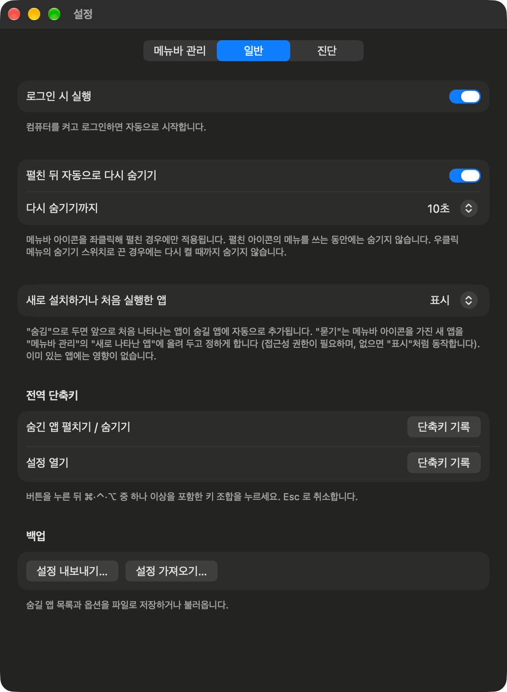

# MenuBarManager 사용 안내서

[English](user-guide.md) · **한국어** · [简体中文](user-guide_CN.md)

[README](../../README_KR.md)의 내용을 단계별로 풀어 쓰고, 자주 겪는 문제의 해결 방법을 모았습니다.

| 절 | 이럴 때 읽습니다 |
|---|---|
| [1. 설치](#1-설치) | 처음 설치하거나, macOS가 앱을 열지 못하게 할 때 |
| [2. 평소 사용법](#2-평소-사용법) | 클릭마다 무슨 일이 일어나는지 |
| [3. 숨길 앱 고르기](#3-숨길-앱-고르기) | **메뉴바 관리** 탭 |
| [4. 순서 바꾸기](#4-순서-바꾸기) | **순서 편집**과 손쉬운 사용 권한 |
| [5. 옵션](#5-옵션) | **일반** 탭 |
| [6. 문제 해결](#6-문제-해결) | 무언가 동작하지 않을 때 |
| [7. 업데이트와 삭제](#7-업데이트와-삭제) | 새 버전으로 바꾸거나 앱을 지울 때 |
| [8. 개인정보와 동작 원리](#8-개인정보와-동작-원리) | 앱이 내 Mac에서 무엇을 다루는지 |

## 1. 설치



1. [최신 릴리스](https://github.com/dohyoh/menubar-manager/releases/latest)에서 `MenuBarManager-<버전>.zip`을 내려받습니다.
2. zip 파일을 두 번 클릭해 압축을 풉니다.
3. `MenuBarManager.app`을 **응용 프로그램** 폴더로 끌어 옮깁니다.
4. 응용 프로그램 폴더에서 앱을 엽니다.

### macOS가 앱을 막을 때

이 앱은 Apple의 공증을 받지 않아서([이유](../adr/0011-unnotarized-release.md)), 처음 열 때 macOS가 경고를 보여 줍니다.

| 방법 | 순서 |
|---|---|
| **시스템 설정** | 1. 앱을 한 번 열어 보고 경고를 닫습니다. 2. **시스템 설정 > 개인정보 보호 및 보안**을 엽니다. 3. 아래로 내려 MenuBarManager에 관한 안내 옆의 **그래도 열기**를 누릅니다. 4. 암호나 Touch ID로 확인합니다. |
| **터미널** | 아래 명령을 실행한 뒤 앱을 다시 엽니다. |

```bash
xattr -dr com.apple.quarantine /Applications/MenuBarManager.app
```

### 앱이 옮겨 달라고 할 때

숨김은 앱이 응용 프로그램 폴더에서 실행될 때만 동작합니다. 다른 위치에서 열면 **응용 프로그램 폴더로 옮기기** 버튼을 보여 줍니다. 누르면 앱이 그곳으로 복사된 뒤 다시 실행됩니다.

## 2. 평소 사용법

앱은 메뉴바에 커튼 모양 아이콘으로 있습니다. 닫힌 커튼은 아이콘을 숨기고 있다는 뜻이고, 열린 커튼은 전부 보이고 있다는 뜻입니다.


| 동작 | 결과 |
|---|---|
| 커튼 아이콘 **좌클릭** | 숨긴 아이콘을 보여 줍니다. 다시 누르면 숨깁니다. |
| 커튼 아이콘 **우클릭** | 메뉴가 열립니다: **숨기기** 스위치, **설정…**, **정보**, **종료** |
| **숨기기** 스위치 끄기 | 다시 켤 때까지 모든 아이콘을 표시합니다 |
| **시계 클릭** | 숨김 중에도 알림 센터가 열립니다 |
| 응용 프로그램 폴더에서 앱을 다시 열기 | 설정 창이 나타납니다 (아이콘을 찾지 못할 때 유용) |



처음 실행하면 숨기기는 **꺼져** 있습니다. 먼저 숨길 앱을 고른 다음([3절](#3-숨길-앱-고르기)) **숨기기**를 켭니다.

### 알림 센터

- 숨김 중에 시계를 누르면 알림 센터가 열립니다. 열려 있는 동안에는 숨긴 아이콘이 보이고, 닫으면 곧바로 다시 숨습니다 (손쉬운 사용 권한이 없으면 더 걸릴 수 있습니다).
- 트랙패드를 두 손가락으로 쓸어서 여는 방법은 숨김 중에는 동작하지 않습니다. 먼저 커튼 아이콘을 좌클릭해 펼칩니다.

### macOS 26 이하에서

macOS 26 이하에서는 숨기는 방식이 다릅니다 (1.0.2 다음 버전부터 지원). 쓰는 방법은 같지만 다음이 다릅니다.

- **숨기려면 손쉬운 사용 권한이 필요합니다.** 숨길 앱의 아이콘을 MenuBarManager가 대신 옮겨야 하기 때문입니다. 권한이 없으면 커튼 아이콘 대신 느낌표 아이콘이 보이고, 설정 창에 안내가 나옵니다. **접근성 권한 요청**을 누르고 **시스템 설정 > 개인정보 보호 및 보안 > 손쉬운 사용**에서 MenuBarManager를 켜면, 잠시 뒤 자동으로 숨기기를 쓸 수 있게 됩니다.
- 숨길 앱을 바꾸거나 숨김 중에 새 앱을 실행하면, 아이콘을 옮기느라 숨긴 아이콘이 잠깐 보이고 포인터가 잠시 움직입니다. 좌클릭으로 펼치고 숨길 때는 그렇지 않습니다.
- 시스템 아이콘은 지금 메뉴바에 있는 것 중 옮길 수 있는 것(Wi-Fi, 배터리, 입력 소스, Siri 등)을 목록 아래쪽 **시스템 아이콘** 구역에서 고릅니다. 시계와 제어 센터는 macOS가 자리를 고정해 둬서 숨길 수 없습니다.
- 숨겼던 아이콘을 다시 표시로 바꾸면 원래 있던 자리로 돌아갑니다. MenuBarManager를 다시 실행한 뒤에 바꾸면 표시된 아이콘들의 왼쪽 끝에 놓입니다 (⌘을 누른 채 끌어 옮길 수 있습니다).
- 알림 센터는 숨김 중에도 평소처럼 열립니다.
- 응용 프로그램 폴더 밖에 있는 앱과 제어 센터 항목도 숨김 중에 표시됩니다.
- 메뉴바에 폭이 좁은 빈칸이 하나 생깁니다. 이 빈칸의 왼쪽에 있는 아이콘이 숨겨지는 아이콘입니다.

## 3. 숨길 앱 고르기

**설정 > 메뉴바 관리**를 엽니다 (커튼 아이콘 우클릭 후 **설정…**).



<sub>예시 앱으로 그린 그림입니다.</sub>

- **스위치 켬** = 아이콘이 메뉴바에 남습니다. **스위치 끔** = 아이콘이 숨겨집니다.
- 목록은 **표시**, **숨김**, **시스템 아이콘**(Wi-Fi, 배터리) 구역으로 나뉩니다. 시계와 제어 센터는 숨기지 않습니다.
- MenuBarManager 자신은 항상 표시됩니다.
- 아래쪽의 **숨기기 켜기 / 끄기** 버튼은 우클릭 메뉴의 숨기기 스위치와 같습니다.

| 필터 | 보여 주는 것 |
|---|---|
| **메뉴바** | 메뉴바 아이콘을 가진 앱만. 손쉬운 사용 권한이 필요합니다. |
| **실행 중** | 지금 실행 중인 앱 |
| **숨긴 앱** | 숨기기로 정한 앱 |
| **전체** | 실행 중이 아닌 설치된 앱까지 모두 |

### 숨김 중에 표시할 수 없는 아이콘

| 항목 | 숨김이 켜져 있는 동안 |
|---|---|
| 응용 프로그램 폴더 밖에 있는 앱 | 표시되지 않음 |
| 제어 센터에서 메뉴바로 꺼낸 항목 (타이머 등) | 표시되지 않음 |

보려면 커튼 아이콘을 좌클릭해 펼치거나 숨기기를 끕니다.

## 4. 순서 바꾸기

1. **설정 > 메뉴바 관리**에서 **순서 편집**을 누릅니다.
2. 처음에는 **접근성 권한 요청**을 누르고, **시스템 설정 > 개인정보 보호 및 보안 > 손쉬운 사용**에서 MenuBarManager를 허용합니다.
3. **메뉴바에서 순서 읽기**를 누릅니다. 목록이 실제 아이콘 순서대로 나타납니다.
4. 줄을 끌어 원하는 순서로 바꿉니다. 시스템 항목은 고정되어 옮길 수 없습니다.
5. **적용**을 누릅니다. 아이콘을 옮기는 몇 초 동안 포인터가 저절로 움직입니다. 끝날 때까지 마우스를 건드리지 않습니다.

**취소**하거나 다른 탭으로 가면 메뉴바는 바뀌지 않습니다.

**⌘(Command)** 키를 누른 채 메뉴바의 아이콘을 직접 끌어도 됩니다. 숨긴 아이콘은 먼저 펼친 다음 옮깁니다.

## 5. 옵션

**설정 > 일반**을 엽니다.



| 옵션 | 하는 일 | 기본값 |
|---|---|---|
| **로그인 시 실행** | 로그인하면 앱을 시작합니다 | 끔 |
| **언어** | **한국어**, **English**, **简体中文** 중에서 고릅니다. macOS에서 쓰고 있는 언어에는 **(시스템)** 이 붙고 처음에 그 언어가 선택되어 있습니다. macOS의 언어를 지원하지 않으면 English가 선택됩니다. 바꾼 언어는 다시 시작해야 적용되며, 바로 아래의 **지금 다시 시작**을 누르면 됩니다. | macOS의 언어 |
| **펼친 뒤 자동으로 다시 숨기기** | 좌클릭으로 펼친 뒤 정한 시간이 지나면 다시 숨깁니다. 펼친 아이콘의 메뉴를 쓰는 동안에는 기다립니다. | 켬 |
| **다시 숨기기까지** | 3, 5, 10, 15, 30, 60초 | 5초 |
| **새로 설치하거나 처음 실행한 앱** | **표시**: 새 아이콘이 보입니다. **숨김**: 새 앱을 자동으로 숨깁니다. **묻기**: 새 앱을 메뉴바 관리의 **새로 나타난 앱**에 올려 두고 정하게 합니다 (손쉬운 사용 권한 필요). | 표시 |
| **전역 단축키** | 펼치기 / 숨기기와 설정 열기에 쓸 키 조합 | 없음 |
| **백업** | **설정 내보내기…** 버튼은 숨길 앱 목록과 옵션을 파일로 저장하고, **설정 가져오기…** 버튼은 불러옵니다. | — |

### 단축키 기록하기

1. **단축키 기록**을 누릅니다.
2. ⌘, ⌃, ⌥ 중 하나 이상을 포함한 키 조합을 누릅니다.
3. 취소하려면 **Esc**를 누릅니다. 단축키를 없애려면 **지우기**를 누릅니다.

조합을 등록하지 못했다는 안내가 나오면 다른 앱이 이미 쓰고 있을 가능성이 큽니다. 다른 조합을 고릅니다.

## 6. 문제 해결

먼저 **설정 > 진단**을 봅니다. 숨김 기능을 쓸 수 있는지, 앱이 응용 프로그램 폴더에 있는지, 손쉬운 사용 권한이 허용되어 있는지 보여 줍니다. **진단 정보 복사**를 누르면 내용이 복사되어 문제 보고에 붙여 넣을 수 있습니다.

| 문제 | 해결 방법 |
|---|---|
| macOS가 앱을 열 수 없다고 함 | [macOS가 앱을 막을 때](#macos가-앱을-막을-때) 참고 |
| 커튼 아이콘을 찾을 수 없음 | 응용 프로그램 폴더에서 MenuBarManager를 다시 엽니다. 설정 창이 나타납니다. |
| 숨기기가 켜지지 않고 앱이 옮겨 달라고 함 | **응용 프로그램 폴더로 옮기기**를 누르거나, 직접 응용 프로그램 폴더로 끌어 옮긴 뒤 다시 엽니다 |
| "이 macOS 버전에서는 숨김 기능을 쓸 수 없습니다" | 이 버전의 앱이 이 macOS에서 숨기는 방법을 갖고 있지 않습니다. macOS 26 이하라면 1.0.2 다음 버전으로 업데이트합니다. |
| "숨기려면 접근성 권한이 필요합니다" (macOS 26 이하) | **접근성 권한 요청**을 누르고 시스템 설정에서 MenuBarManager를 켭니다. 켰는데도 그대로면 [업데이트](#업데이트)의 4번처럼 권한 항목을 초기화한 뒤 다시 켭니다. |
| 스위치는 켜져 있는데 아이콘이 보이지 않음 | 그 앱이 응용 프로그램 폴더 밖에 있거나 제어 센터 항목입니다. [3절](#숨김-중에-표시할-수-없는-아이콘) 참고 |
| 업데이트 후 순서 편집이 동작하지 않음 | 손쉬운 사용 권한을 다시 허용합니다. [업데이트](#업데이트) 참고 |
| 트랙패드를 쓸어도 알림 센터가 열리지 않음 | 먼저 커튼 아이콘을 좌클릭해 펼치거나, 시계를 누릅니다 |
| 단축키를 눌러도 반응이 없음 | 다른 조합으로 다시 기록합니다. 다른 앱이 쓰고 있을 수 있습니다. |
| 설정이 초기화됨 | 설정 파일을 읽지 못하면 앱은 기본값으로 시작하고, 이전 파일을 설정 폴더에 `state.unreadable.json`으로 남깁니다 ([8절](#8-개인정보와-동작-원리) 참고). |

해결되지 않으면 [이슈](https://github.com/dohyoh/menubar-manager/issues)를 열고 복사한 진단 정보를 붙여 넣어 주세요.

## 7. 업데이트와 삭제

### 업데이트

1. [최신 릴리스](https://github.com/dohyoh/menubar-manager/releases/latest)에서 새 zip을 내려받습니다.
2. MenuBarManager를 종료합니다 (커튼 아이콘 우클릭 후 **종료**).
3. 응용 프로그램 폴더의 앱을 새 것으로 바꾸고 엽니다. 처음 열 때 macOS가 다시 막을 수 있습니다 ([1절](#macos가-앱을-막을-때)).
4. 손쉬운 사용 권한을 다시 허용합니다. 이전 권한 항목은 새 버전과 맞지 않으므로, 먼저 터미널에서 초기화합니다.

   ```bash
   tccutil reset Accessibility dev.menubarmanager.app
   ```

   그다음 **순서 편집**에서 **접근성 권한 요청**을 누르고 시스템 설정에서 MenuBarManager를 허용합니다.

설정은 그대로 유지됩니다.

### 삭제

1. **설정 > 일반**에서 **로그인 시 실행**을 끕니다.
2. MenuBarManager를 종료합니다. 숨긴 아이콘이 모두 돌아옵니다.
3. 응용 프로그램 폴더의 `MenuBarManager.app`을 휴지통으로 옮깁니다.
4. 선택 사항: 설정 폴더 `~/Library/Application Support/MenuBarManager`를 지웁니다.

## 8. 개인정보와 동작 원리

| 주제 | 내용 |
|---|---|
| **네트워크** | 네트워크에 연결하지 않습니다. |
| **설정 파일** | `~/Library/Application Support/MenuBarManager/state.json` — 숨길 앱 목록과 옵션. 그 밖에는 저장하지 않습니다. |
| **손쉬운 사용 권한** | 메뉴바 아이콘의 위치를 읽고 옮기는 데 씁니다. macOS 27에서는 선택 사항이고, macOS 26 이하에서는 숨기기에 필요합니다. |
| **숨김의 원리** | macOS 27: macOS의 비공개 기능으로, 메뉴바에 아이콘을 표시할 수 있는 앱을 제한합니다. 비공개 기능이라 macOS 업데이트로 바뀔 수 있습니다. macOS 26 이하: 이 앱의 보이지 않는 아이콘을 아주 길게 늘여, 그 왼쪽에 있는 아이콘을 화면 밖으로 밀어냅니다. |
| **문제가 생기면** | 어떤 오류에서도 모든 아이콘을 표시하는 상태로 돌아가도록 만들었습니다. |

개발자용 문서: [플랫폼 조사 기록](../architecture/platform-notes.md) · [구조](../architecture/overview.md) · [결정 기록](../adr/README.md)
